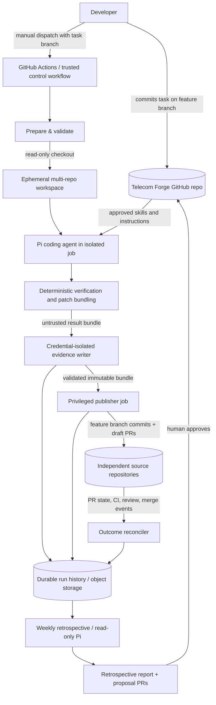

# Telecom Forge

**Architecture and Implementation Specification**  
**Status:** Proposed / ready for implementation  
**Version:** 1.0  
**Date:** 2026-10-26  
**Audience:** Coding agent implementing the initial telecom-specific metarepository  
**Default harness:** Pi, behind a replaceable adapter

> **Instruction to the implementing agent:** Build the system specified in this document, not a generic reusable product. Make sensible implementation choices where details are unspecified; record those decisions as ADRs. Deliver working code, tests, developer documentation, and GitHub Actions workflows. Do not assume actual telecom source repository names, API credentials, GitHub organization, or AWS resources. Use configurable placeholders, mock integrations, and a fully runnable local mode. Do not perform real pushes or create cloud resources without explicit configuration and authorization.

---

## 1. Vision and scope

Telecom Forge is a **team-owned engineering metarepository** that coordinates AI-assisted development across a collection of existing, independent telecom software repositories. It does not move those repositories into a monorepo. It is a contextual and operational layer around them.

A developer prepares a task on a feature branch of Telecom Forge, at a defined task path. A GitHub Actions workflow reads that task from the developer's branch, constructs a temporary multi-repository workspace, runs a coding harness, validates generated changes, publishes changes to corresponding feature branches in affected source repositories, and creates or updates draft pull requests for developer review.

Every execution, including failed and cancelled executions, leaves durable, structured evidence. A separate weekly retrospective workflow analyzes runs, PR reviews and outcomes, recurring bottlenecks, and previously attempted improvements. It creates an evidence-based retrospective and optionally proposes skill, documentation, or tool improvements for human approval.

The broader idea is a **methodology** that other teams may independently adopt. This implementation is specifically for the user's telecom projects. Avoid building a highly configurable multi-tenant product or a marketplace of generic workflows.

### 1.1 Goals

1. Make organizational and telecom-domain knowledge discoverable by coding agents.
2. Allow a developer to define a reviewable task on a feature branch without manually gathering every repository.
3. Read across approved repositories, but edit only explicitly permitted targets.
4. Execute headlessly in CI, with deterministic preparation and post-processing.
5. Publish independently reviewable changes to existing source repositories, never directly to main.
6. Persist complete provenance, normalized events, verification evidence, outputs, costs and outcomes.
7. Learn from a week of work and propose verifiable improvements to the metarepo's skills and scripts.
8. Keep control-plane logic independent of the AI model and coding harness.
9. Support local rehearsal with fake GitHub and filesystem-backed history.
10. Minimize permissions, external dependencies, operational overhead and accidental duplicate work.

### 1.2 Non-goals for the initial version

- No replacement for GitHub, code review, CI, issue tracking, or deployment tooling.
- No automated merge, deployment, production access, or self-approval.
- No generic commercial platform, multi-tenant SaaS, dashboard or database cluster.
- No mandatory web UI; the CLI, GitHub PRs, Markdown reports and JSON data are sufficient.
- No unbounded autonomous task discovery or recursive self-improvement.
- No assumption that all telecom services use Java, Spring Boot, Gradle, TM Forum, or the same build system.
- No automatic transformation of retrospective recommendations into authoritative skills without human review.
- No attempt to make Pi's entire raw session transcript into a permanent system prompt.

### 1.3 Design principles

- **Metarepo = control plane; source repositories = code source of truth.**
- **History is evidence; skills are curated knowledge.** Keep them separate.
- **Read broad, write narrow.** A task may read many repositories but write only declared targets.
- **Agent proposes; deterministic scripts verify and publish; developer approves.**
- **Fail closed** on unknown repositories, ambiguous refs, malformed task metadata, unsafe file paths, changed base commits, missing tests, missing credential boundaries, and incomplete event streams.
- **Immutable provenance:** Record exact commits of task, control plane, skills, source repositories and harness/model versions.
- **Idempotence:** Reruns may update the same feature branches/PRs but must not create duplicate PRs, overwrite developer changes or silently lose history.
- **Evidence-based retrospectives:** Recommendations must be tied to concrete runs, measurements and review outcomes.

---

## 2. System overview



### 2.1 Components and ownership

| Component | Responsibility | May edit code? | GitHub write access? |
|---|---|---|---|
| Task author | Defines intent, scope and acceptance criteria | Task branch | Developer-owned |
| Validator / preparer | Validates task, resolves pinned SHAs, checks repo allowlist | No | Read-only GitHub App token temporarily |
| Workspace manager | Materializes approved repos into `repos/` | No, except local clone operations | None at agent runtime |
| Agent harness adapter | Runs Pi / other harness, collects lifecycle events | Via coding process inside workspace | No |
| Verifier | Runs approved build/test checks, creates patch bundle | No intentional edits; clean builds and recheck | No |
| Publisher | Validates patch and commit provenance, creates branches and draft PRs | Applies vetted patches | Narrow GitHub App write token |
| Evidence writer | Persists agent sessions and verified patch bundle, then releases a trusted artifact reference | No | Only narrow history-store write permissions; separate job |
| History finalizer | Persists publish/outcome records and summaries | No | Only narrow history-store write permissions; separate job |
| PR outcome reconciler | Samples PR reviews, checks, merges and rejections | No | GitHub read-only |
| Retro analyzer | Calculates metrics and analyzes summarized evidence | No source changes | No GitHub write access |
| Retro publisher | Opens report and improvement proposal PRs | Only metarepo report/proposal branch | Narrow metarepo write token |

### 2.2 Repository model

Telecom Forge is one Git repository. Every source repository remains an independent Git repository with its own history, default branch, CI, protected branches and review policy. The `repos/` directory is a **gitignored, ephemeral checkout area**, not a committed subtree or Git submodule collection. Source repositories are cloned using a trusted manifest. Local use may point approved entries at local remotes.

A single branch name does not refer to a single cross-repository Git branch. The task's `feature_branch` is a logical work identifier. For each writable source repository, the publisher creates or updates a branch with that same name **inside that repository**. Each repository gets its own commit(s) and PR. Multiple PRs share the same `task_id` and run provenance.

---

## 3. Repository structure

```text
telecom-forge/
├── README.md
├── AGENTS.md                         # Short, authoritative agent charter
├── package.json
├── pnpm-lock.yaml
├── tsconfig.json
├── .gitignore
├── .github/
│   ├── workflows/
│   │   ├── validate-task.yml
│   │   ├── implement-task.yml
│   │   ├── reconcile-outcomes.yml
│   │   └── weekly-retro.yml
│   ├── CODEOWNERS
│   └── pull_request_template.md
├── .agents/
│   └── skills/
│       ├── organization-navigation/SKILL.md
│       ├── telecom-domain/SKILL.md
│       ├── tmf-api-conventions/SKILL.md
│       ├── repository-build-and-test/SKILL.md
│       ├── cross-repo-change/SKILL.md
│       ├── architecture-and-decisions/SKILL.md
│       ├── task-implementation/SKILL.md
│       ├── code-review-readiness/SKILL.md
│       └── retrospective-analysis/SKILL.md
├── catalog/
│   ├── workspace.yaml                # Approved repos + trusted repo policy
│   ├── repositories.md               # Human-readable map and ownership
│   ├── services.md                   # Service responsibilities and relationships
│   ├── dependency-map.md
│   ├── build-profiles.yaml
│   └── glossary.md
├── docs/
│   ├── architecture.md
│   ├── workflow.md
│   ├── threat-model.md
│   ├── local-development.md
│   ├── history-and-retro.md
│   ├── onboarding.md
│   └── adr/
│       ├── 0001-pi-as-first-harness.md
│       ├── 0002-github-app-tokens.md
│       ├── 0003-execution-history-storage.md
│       └── 0004-publish-through-patches.md
├── schemas/
│   ├── workspace.schema.json
│   ├── task.schema.json
│   ├── event.schema.json
│   ├── run-summary.schema.json
│   ├── patch-manifest.schema.json
│   └── improvement.schema.json
├── tasks/
│   ├── README.md
│   ├── _template/
│   │   ├── task.yaml
│   │   └── task.md
│   └── TF-0001/
│       ├── task.yaml
│       └── task.md
├── prompts/
│   ├── implement.md
│   ├── resume.md
│   └── retrospective.md
├── src/
│   ├── cli.ts
│   ├── config/
│   ├── tasks/
│   ├── workspace/
│   ├── harness/
│   │   ├── types.ts
│   │   ├── pi-adapter.ts
│   │   └── pi-events.ts
│   ├── verify/
│   ├── patch/
│   ├── publisher/
│   ├── github/
│   ├── history/
│   │   ├── storage.ts
│   │   ├── filesystem-store.ts
│   │   └── s3-store.ts
│   ├── metrics/
│   ├── retrospective/
│   ├── security/
│   └── lib/
├── extensions/
│   └── telemetry.ts                  # Optional Pi-specific extension
├── tests/
│   ├── fixtures/
│   ├── unit/
│   ├── integration/
│   ├── security/
│   └── e2e/
├── retrospectives/
│   ├── README.md
│   └── 2026/
│       └── 2026-W44.md
├── improvements/
│   └── proposals/
├── scripts/
│   ├── local-setup.sh
│   └── smoke-test.sh
├── repos/                            # gitignored; created on demand
└── .forge-runtime/                   # gitignored; task/session/bundles/cache
```

`tasks/TF-0001/` is illustrative. `repos/` and `.forge-runtime/` **must** be gitignored. Do not commit OAuth tokens, private keys, provider configuration with secrets, raw execution sessions, checkout contents, or run outputs to the normal branch.

---

## 4. Trust boundaries: main branch versus task branch

This distinction is critical. A developer's task branch can be edited freely; it is not trusted to define privileged CI behavior.

**Trusted control content:** the workflow files, source code of Telecom Forge, repository allowlist, build profiles, approved skills, prompts and publisher policy from the metarepo's protected default branch, at a pinned control SHA.

**Untrusted task content:** `tasks/<task_id>/task.yaml` and `task.md` read from the named feature branch at a pinned `task_sha`. Treat these documents as instructions to a restricted agent, not as executable authority. Do not run scripts, load extensions, approve repositories, load new skills or change GitHub permissions based on task-branch content.

The task may request a permitted repository and describe edits, but it cannot broaden the allowlist, add GitHub secrets, change deployment privileges, alter workflow definitions, or replace trusted skill text. Changes to Telecom Forge's own skills/configuration go through ordinary protected-branch PRs.

To reduce exposure, trigger the implementation workflow using a **manual dispatch on the trusted default branch**, passing a `task_branch` and `task_path` as input. The workflow checks out the trusted control SHA and separately reads task files from the developer branch. Do not run a workflow revision supplied by the task branch.

---

## 5. Trusted repository catalog and workspace configuration

Create a typed, schema-validated `catalog/workspace.yaml`. Repository identities must come exclusively from this trusted file. The URLs and commands shown here are illustrative placeholders, **not claims about existing repositories**.

```yaml
schema_version: 1
workspace:
  name: telecom-forge
  source_directory: repos
  working_directory: .
  organization: YOUR_GITHUB_OWNER

harness:
  adapter: pi
  provider_env: FORGE_MODEL_PROVIDER
  model_env: FORGE_MODEL_ID
  max_runtime_minutes: 45
  max_attempts_per_task: 2

policy:
  require_draft_pr: true
  allow_direct_merge: false
  allow_unlisted_repositories: false
  allow_modified_workflows: false
  allow_deployments: false
  max_writable_repositories: 3
  max_patch_bytes_per_repository: 5000000
  fail_on_base_branch_movement: true
  permitted_branch_prefixes: [feature/, agent/]

history:
  backend: filesystem  # CI must override to s3 before production use
  local_root: .forge-runtime/history
  s3_bucket_env: FORGE_HISTORY_BUCKET
  s3_prefix: telecom-forge/v1

repositories:
  telecom-api-sandbox:
    owner: YOUR_GITHUB_OWNER
    name: telecom-api-sandbox
    checkout_path: repos/telecom-api-sandbox
    default_branch: main
    access: read-write
    build_profile: node-example
    owned_by: telecom-platform
    description: Telecom API sandbox (illustrative settings)

  shared-contracts:
    owner: YOUR_GITHUB_OWNER
    name: YOUR_SHARED_CONTRACTS_REPO
    checkout_path: repos/shared-contracts
    default_branch: main
    access: read-only
    build_profile: none
    owned_by: telecom-platform
    description: Example cross-service schemas; configure when real
```

Requirements:

- Validate aliases, GitHub repository ownership, paths, access level, branch names and build-profile references.
- Reject duplicate checkout directories, absolute checkout paths, traversal (`../`), symlink escapes, suspicious protocol/URL formats and user-supplied remote URLs.
- Use explicit clone URLs derived from approved `owner` and `name`. Do not accept arbitrary URLs in task metadata.
- Resolve each checkout to an immutable Git SHA and record the resolution.
- Support `read-only` and `read-write` repositories; by default all are read-only until explicitly configured otherwise.
- Treat the build profile as a trusted set of verification commands. Task text cannot inject additional privileged commands into the verifier.
- For a task, fetch only named target and context repositories plus their explicit required dependencies, not every repository in the organization.
- Do not assume that filenames, modules or TM Forum versions are the same across repositories.

### 5.1 Build profiles

Provide a trusted `catalog/build-profiles.yaml` mapping profile IDs to bounded, ordered commands with working directories, timeouts, artifact limits and environment allowlists. Profiles may include `gradle-java`, `maven-java`, `node`, `python`, and `none`. Implement at least `none` and one lightweight illustrative profile in the initial version; leave language-specific additions configurable.

Example:

```yaml
schema_version: 1
profiles:
  none:
    commands: []
  node-example:
    commands:
      - id: install
        argv: [corepack, pnpm, install, --frozen-lockfile]
        timeout_seconds: 300
      - id: test
        argv: [corepack, pnpm, test]
        timeout_seconds: 600
      - id: build
        argv: [corepack, pnpm, build]
        timeout_seconds: 600
```

The verifier invokes `argv` without a shell. Only trusted profile files may define these commands. Avoid executing arbitrary commands from task YAML or agent-generated metadata.

---

## 6. Task contract

A task comprises **machine-readable metadata** and a **human-authored Markdown specification**. Both live on the developer's metarepo feature branch under `tasks/<task_id>/`.

Example `tasks/TF-0001/task.yaml`:

```yaml
schema_version: 1
id: TF-0001
title: Add TMF API pagination coverage
feature_branch: feature/TF-0001
spec_file: task.md

scope:
  writable_repositories: [telecom-api-sandbox]
  context_repositories: [shared-contracts]

requirements:
  implementation_required: true
  require_tests: true
  draft_pull_requests: true

acceptance:
  - Request pagination parameters are validated.
  - Default behavior remains backward-compatible.
  - Positive and negative test cases pass.

constraints:
  - Avoid unrelated refactoring.
  - Follow existing TMF contract versions in the target codebase.
```

Example `task.md`:

```markdown
# TF-0001: Add TMF API pagination coverage

## Context
Describe why the feature matters and link to relevant code or issues.

## Expected behavior
Describe observable behavior, compatibility constraints and error cases.

## Scope
The approved task manifest controls write access. Read related contracts as needed.

## Acceptance examples
1. Given a valid page request, the endpoint returns the expected segment.
2. An invalid offset is rejected according to the existing API contract.
3. Existing API regression tests remain green.

## Out of scope
Do not upgrade API major versions, redesign the framework, or deploy services.

## Open questions
Record ambiguities. If a consequential ambiguity cannot be resolved from
existing code and skills, report it rather than guessing.
```

### 6.1 Task validation

Implement `forge validate-task --task-ref <ref> --task-path tasks/<id>/task.yaml`:

1. Resolve the supplied metarepo branch to an exact commit SHA; verify its ref syntax and authorized owner when possible.
2. Load task files from that SHA only; never execute branch-local scripts.
3. Validate against JSON Schema / Zod and require path consistency (`id` matches task directory).
4. Enforce bounded lengths and UTF-8 format; reject duplicate YAML keys.
5. Require at least one writable repository and one test/acceptance criterion (allow an explicit exception for documentation-only tasks).
6. Intersect requested scope with the trusted catalog; no permission escalation via task metadata.
7. Verify current user/trigger authorization, task ref existence and configured GitHub App repository access.
8. Record a canonical, SHA-256 hashed task snapshot in the prepared result, then durably persist it in the credential-isolated history phase.
9. Emit a machine-readable validation result and clear diagnostics.

A task can be retried with the same task SHA; changes to task files imply a new task revision. Never silently switch a running task to the branch's latest commit.

---

## 7. Developer experience and CLI

Implement a single TypeScript CLI, invoked through `pnpm forge <command>`; use a `package.json` bin command if convenient. Recommended Node.js >= 22, strict TypeScript, `zod`, `yaml`, `@octokit/rest` (or supported Octokit client), `execa`, a date-time library with IANA timezones, and a test runner such as Vitest. Pin package versions in the lockfile.

Expected commands:

```text
forge doctor                                Check local tools, config and credentials
forge init-task --id TF-0001 --branch feature/TF-0001
forge validate-task --task-ref feature/TF-0001 --task-path tasks/TF-0001/task.yaml
forge prepare --task-ref ... --task-path ... --output .forge-runtime/prepared
forge run --prepared .forge-runtime/prepared --harness pi
forge verify --run-id <id>
forge bundle --run-id <id>
forge publish --bundle <path> --dry-run
forge publish --bundle <path> --apply
forge reconcile --since 2026-10-19
forge retro --week 2026-W43 --dry-run
forge retro --week 2026-W43 --propose
forge history show --run-id <id>
```

`--help` must describe each argument. Commands should support `--json` for automation. Local commands use filesystem history; production commands use the configured object store. `--dry-run` is the default for publishing outside CI.

### 7.1 Normal developer flow

1. Developer creates `feature/TF-0001` from protected Telecom Forge `main`.
2. Developer runs `forge init-task` or copies the template, edits the task metadata and Markdown, and commits them.
3. Developer reviews the task diff and starts `implement-task.yml` using GitHub's Run workflow UI, or:

   ```bash
   gh workflow run implement-task.yml --ref main \
     -f task_branch=feature/TF-0001 \
     -f task_path=tasks/TF-0001/task.yaml
   ```

4. Workflow validates, prepares, executes, verifies and publishes draft PRs.
5. Developer reviews source PR(s); CI and review continue in each source repository.
6. Developer may revise the task and rerun. The new task SHA is stored as a separate run/attempt.
7. Outcome reconciler associates subsequent review, merge or rejection events with the logical task.
8. Weekly retrospective aggregates completed and unfinished work.

The metarepo branch remains the **task definition branch**. It does not magically become the single source branch for every external repository. PR links and run summaries may be posted to the task's metarepo PR as comments, without needing to push generated code into the metarepo task branch.

---

## 8. Implementation workflow and state machine

### 8.1 Task and attempt states

Use separate state models:

**Task:** `DEFINED -> READY -> RUNNING -> REVIEW_PENDING -> ACCEPTED | REJECTED | ABANDONED`.

**Run:** `CREATED -> VALIDATING -> PREPARING -> AGENT_RUNNING -> VERIFYING -> BUNDLING -> PUBLISHING -> PUBLISHED`, with terminal variants `VALIDATION_FAILED`, `AGENT_FAILED`, `VERIFICATION_FAILED`, `PUBLISH_FAILED`, `CANCELLED`, `TIMED_OUT`, `BLOCKED_STALE_BASE`.

**PR:** `DRAFT -> OPEN -> CHANGES_REQUESTED | APPROVED -> MERGED | CLOSED_UNMERGED`. These are observational states and may be revisited; do not assume a linear review sequence.

A run's `PUBLISHED` state means draft PRs were created/updated, **not** that the feature was accepted. `ACCEPTED` is derived from human-reviewed outcomes, with a policy for tasks with multiple PRs (e.g., all required target PRs merged).

### 8.2 Trusted preparation phase

1. Resolve task/control SHAs.
2. Check target aliases, write policies, authentication, branch collisions and parallel-run lock.
3. Resolve the base reference for every source repository. If the task's feature branch already exists in a source repo, use its current head as the starting checkout; otherwise use its configured default branch.
4. Capture `base_sha` for each checkout, plus the base/default branch SHA the PR will target.
5. Clone approved repositories to `repos/<alias>`; no submodules or LFS pulls unless explicitly allowed in trusted catalog.
6. Remove all Git credential helpers, remotes with embedded tokens, temporary token files and secret environment variables **before the agent begins**. `actions/checkout` should use `persist-credentials: false`.
7. Materialize trusted `AGENTS.md`, approved skills and agent prompt from the pinned control SHA, and the exact task snapshot from the pinned task SHA.
8. Write `prepared-manifest.json` containing resolved SHAs, policies and hashes.
9. Produce an immutable workspace handoff artifact for the unprivileged job. Protect artifact access; it contains source code.

### 8.3 Agent execution phase

- Run the coding process in a fresh workspace/container with only necessary files, an approved model API interface, and **no GitHub write token, GitHub App private key, deployment credentials or cloud administrator credentials**.
- Have Pi inspect `AGENTS.md`, task and approved skills. The agent may use its normal read/edit/write/bash tools only inside the restricted environment.
- Agent may edit only allowed repo paths; filesystem permissions and post-run policy checks provide independent enforcement. A textual instruction is not a security boundary.
- Agent must not `git push`, `gh pr create`, merge, deploy, mutate the metarepo control plane, install arbitrary Pi extensions, or read unrelated secrets.
- Cap runtime and output sizes; collect explicit events and session files; terminate cleanly on timeout or cancellation.
- When ambiguity matters for compatibility or safety, agent records it and marks the task blocked instead of fabricating requirements.
- In first version, run only **one coding agent** for a task. Do not introduce agent swarms or coordinator/subagent graphs.

### 8.4 Verification and patch bundling phase

1. Parse agent JSONL events and inspect the final terminal state. **Pi JSON-mode exit code alone is insufficient**: aborted/errored responses may appear in the stream even if the CLI exits zero. Wait for `agent_settled`; reject missing, aborted or failed final turns.
2. Run approved build/test commands (trusted profiles) with bounded time and output; record complete success/failure evidence.
3. Reject modifications outside approved target repositories or within protected paths (e.g., `.github/workflows/`, credential files, `.git/`, publication scripts) unless an explicit protected-branch policy allows them.
4. Inspect newly added files, symlinks, submodules, binary files and deletion counts. Enforce size and file-type limits. Run secret scanning against changed content, with the understanding that scanners are not perfect.
5. Stage all allowed tracked/untracked changes **inside the ephemeral checkout only**, and produce a binary-aware Git patch for each changed repository, including additions/deletions, against its `base_sha`.
6. Produce a signed/hashed manifest of expected base commit, changed paths, file modes, patch hash, verification outcomes, task SHA and policy SHA. Signing is optional in MVP; SHA-256 and job/artifact provenance are required.
7. Record `NO_CHANGE` as a distinct outcome; do not create empty PRs.
8. If verification fails, package diagnostic patches, events and logs for the isolated evidence writer, but **do not publish source changes** unless a separate explicit human-authorized override mechanism is later designed.
9. The credential-isolated evidence writer must upload the validated bundle and verify that it is durably stored **before** privileged publication can begin. If durable persistence fails, publication is blocked; report the failure and retain a short-term recovery artifact.

### 8.5 Publication phase

Run in a **different privileged GitHub Actions job**. It does not invoke Pi, evaluate task text, run agent-generated code, or execute scripts from modified source trees.

For each changed target repository:

1. Require a successful durable-evidence receipt from the history writer. Revalidate immutable task/config/policy hashes and the patch bundle manifest.
2. Obtain a narrowly scoped GitHub App installation token for just the required repository/repositories. Use GitHub App rather than assuming the default `GITHUB_TOKEN` can write other repositories.
3. Fetch the exact expected source feature branch head. If it has moved since preparation, stop with `BLOCKED_STALE_BASE`. Do not force-push or silently rebase on someone else's work.
4. If feature branch does not exist, create it from the captured default-branch SHA; if it exists, require its head to match captured `base_sha`.
5. Apply the validated patch with `git apply --check` and `git apply --index` in a clean checkout; reject patch failures, unexpected path changes and any alteration of protected files.
6. Commit only staged approved source changes. Use a bot identity, conventional commit message and `Task-ID: TF-0001` / `Forge-Run-ID: ...` trailers.
7. Push with compare-and-swap semantics where possible. Never force-push. Detect races, report them, and avoid overwriting other work.
8. Create or update **one draft PR per repository per logical task branch**. Use GitHub API to search existing open PRs before creation. Set base branch from trusted catalog.
9. PR body includes task link, acceptance criteria, summary, verification results, exact run ID and hashes, related cross-repo PRs, and any known limitation; no raw model thoughts, secrets or large logs.
10. Persist PR URLs and commit SHAs immediately after each successful publication step.

**Partial publication:** GitHub does not offer a transaction across repositories. If repo A publishes and repo B fails, record `PARTIAL_PUBLISH`; retain already opened draft PRs, clearly label the incomplete change set, and provide a deterministic resume command. Never claim all repositories succeeded. The reconciler must detect and report cross-repo inconsistency.

### 8.6 Branch concurrency and idempotency

- Workflow concurrency key: normalized logical task identity (e.g., `forge:TF-0001`), with `cancel-in-progress: false`. Queue repeated runs rather than silently cancel one in progress.
- Use an additional publisher-side optimistic check on target branch head, because concurrent work can originate outside the metarepo.
- Idempotency key: `(task_id, task_sha, source_base_sha_by_repo, harness_config_sha)` for a logical execution; individual GitHub run IDs remain unique attempts.
- Before opening PRs, query by repository/branch/task metadata and update the existing PR rather than duplicate it.
- On retry after partial publication, skip repositories already published with the same patch hash and expected resulting commit SHA.
- For unchanged tasks, avoid rerunning expensive work unless `force` is explicit.

---

## 9. Pi integration and harness abstraction

### 9.1 Harness interface

Do not let the rest of Telecom Forge know about Pi-specific event formats or CLI flags. Implement a minimal adapter contract:

```ts
export interface CodingHarness {
  readonly name: string;
  run(input: HarnessRunInput, sink: EventSink): Promise<HarnessRunResult>;
}

export interface HarnessRunInput {
  runId: string;
  taskId: string;
  workingDirectory: string;
  taskMarkdown: string;
  trustedInstructionsPath: string;
  trustedSkillsDirectory: string;
  sessionDirectory: string;
  outputDirectory: string;
  modelProvider: string;
  modelId: string;
  timeoutMs: number;
}

export interface HarnessRunResult {
  state: 'completed' | 'failed' | 'aborted' | 'timed_out';
  exitCode: number | null;
  sessionFiles: string[];
  rawEventFile: string;
  normalizedEventFile: string;
  usage: { inputTokens?: number; outputTokens?: number; cachedTokens?: number; estimatedUsd?: number };
  errors: string[];
}
```

A second adapter (Codex/Claude/OpenCode) can be added later without changing task, publisher, history or retrospective contracts.

### 9.2 Pi execution design

Use the official `@earendil-works/pi-coding-agent` distribution as documented by `pi.dev` (pin an actual tested version in `package.json` / lockfile). Use JSON mode for the MVP; upgrade to RPC or SDK only if bidirectional control or in-process extensibility becomes necessary.

Illustrative invocation (executed from the prepared workspace root):

```bash
pi --mode json \
  --provider "$FORGE_MODEL_PROVIDER" \
  --model "$FORGE_MODEL_ID" \
  --session-dir "$FORGE_OUTPUT_DIR/pi-sessions" \
  --no-extensions \
  --extension "$FORGE_CONTROL_DIR/extensions/telemetry.ts" \
  --no-skills \
  --skill "$FORGE_CONTROL_DIR/.agents/skills" \
  --no-context-files \
  --no-mcp \
  --append-system-prompt "$FORGE_CONTROL_DIR/AGENTS.md" \
  --append-system-prompt "$FORGE_CONTROL_DIR/prompts/implement.md" \
  @task/task.md \
  'Implement the task in approved repository paths. Run relevant checks. Do not commit or push.' \
  > "$FORGE_OUTPUT_DIR/pi-events.jsonl" \
  2> "$FORGE_OUTPUT_DIR/pi-stderr.log"
```

The wrapper must use `spawn()` with argument arrays rather than shell interpolation, and stream stdout/stderr continuously. Confirm CLI flags against **the installed, pinned Pi version** (`pi --help`). The project path layout and `@task/task.md` location in this example must be arranged by the preparer.

The explicit `--no-skills` + `--skill` and `--no-extensions` + `--extension` pattern prevents arbitrary discovered project-local resources from loading during automated runs. `--no-context-files` avoids accidentally importing instructions from untrusted source repos; the control instructions are appended explicitly. Never accept task-provided extension paths.

### 9.3 JSONL event processing

Pi emits `agent_start`, `turn_start`, `message_end`, `tool_execution_start`, `tool_execution_end`, `auto_retry_start`, `compaction_*`, `agent_end` and `agent_settled` among other events. Parse LF-terminated records, not generic JavaScript `readline` Unicode line splitting. Treat `message_end` as authoritative for a complete message; streamed usage/delta messages are not independent billable turns. Count usage from completed assistant messages without double-counting message updates.

Execution is complete only when the wrapper observes terminal `agent_settled` and no final error/abort condition; a successful process exit is necessary but not sufficient. A truncated stream must be classified as incomplete. Store the original Pi stream privately and map it to Forge's normalized event types.

Telemetry extension in `extensions/telemetry.ts` is optional for MVP; the JSON stream alone covers many events. Add an extension only where the standardized record requires hooks not present in the stream, e.g., skill activation or custom run markers. Avoid writing the same usage event twice.

### 9.4 Agent instruction contract

`AGENTS.md` must be short and operational. It must state:

1. Read the assigned task and trusted repository map before changing code.
2. Use appropriate telecom, repository, build and API skills on demand.
3. Prefer existing architecture and contracts to speculative redesign.
4. Distinguish TM Forum normative requirements from local implementation choices; identify actual API/version in source before modifying.
5. Do not edit unapproved repositories or protected paths.
6. Run relevant tests and record exact commands/results.
7. Do not push, merge, deploy, alter credentials or create PRs.
8. Report unresolved ambiguity, unsafe assumptions and blocked work.
9. Produce a concise final implementation summary with affected repositories, verification and caveats.

The agent-facing task prompt should not contain repository credentials, secret paths, or unrelated raw session history.

---
## 10. Organizational skills and telecom knowledge

A skill is an **on-demand instruction bundle**, not an executable agent or universal shared library. Keep individual skills narrowly scoped, practical and linked to up-to-date facts. Use standard `SKILL.md` files with `name` and `description` frontmatter and relative `references/` assets.

Minimum initial skills:

| Skill | Contents and expected behavior |
|---|---|
| `organization-navigation` | How to identify a service's owning repo, module, language, dependencies, integration direction and relevant tests. Refer to `catalog/`. |
| `telecom-domain` | Telecom vocabulary: product/service/resource, order vs service order, fulfillment and assurance, orchestration, inventory, eventing, downstream activation. Mark local definitions where different. |
| `tmf-api-conventions` | How to locate local TM Forum schemas and actual API versions, follow locally adopted event/error/pagination conventions, and avoid inventing normative behavior. |
| `repository-build-and-test` | How to discover trusted build profiles, execute relevant tests, and find targeted module tests. No assumed universal Gradle/Maven command. |
| `cross-repo-change` | How to reason about API compatibility, library dependency order, version changes, contract tests, and sequencing multiple PRs. |
| `architecture-and-decisions` | Existing architectural decisions, tradeoffs, boundaries and links to approved ADRs. |
| `task-implementation` | Scope discipline, acceptance criteria, execution checklist, evidence collection, stop conditions. |
| `code-review-readiness` | Code style, review summary, test evidence, migration notes, dependency PRs and rollback caveats. |
| `retrospective-analysis` | How to distinguish repeated defects from isolated incidents, make evidence-based recommendations and verify previous changes. |

Example `.agents/skills/organization-navigation/SKILL.md`:

```markdown
---
name: organization-navigation
description: Find the correct telecom repository, module, service owner, integration and tests for a development task. Use before editing unfamiliar services or coordinating changes across repositories.
---

# Navigate the organization

1. Read `catalog/repositories.md` and `catalog/services.md` from the metarepo root.
2. Search only checked-out, approved repositories.
3. Identify the owning service and the direction of integrations.
4. Check contract versions in code rather than assuming a TMF version.
5. Identify the narrowest test suite and dependencies.
6. If ownership or architecture is unclear, record the question; do not guess.

Do not modify the trusted repository catalog during a source implementation task.
```

Other rules:

- Prefer **links to canonical material** rather than repeating enormous internal documentation in every skill.
- Distinguish `facts` (grounded repository names, paths, versions), `conventions` (team policy), and `recommendations` (judgment that can change).
- Keep the skills' textual claims testable where possible: e.g. checked paths, commands and ownership.
- Include a `last_verified` date and relevant repository SHA in external references; a periodic/manual docs-validation check can find broken references.
- Only protected-branch-approved skills are loaded in production. Task branches cannot silently replace them.
- No company secrets, production credentials, customer data, private tickets or real subscriber/telephone data in skill files.
- Retro may **propose** additions or corrections, but modifications require a reviewable PR with the evidence and measurements prompting the change.

---

## 11. Durable execution history: data model

The history system has three distinct outputs:

1. **Raw evidence:** Pi session JSONL, event stream, stderr, test logs, diagnostics, hashed patch bundles and CI metadata. Restricted access, potentially sensitive.
2. **Normalized history:** small, stable machine-readable records and event summaries that can be queried independently of Pi.
3. **Curated learning:** weekly retrospectives and approved organizational guidance committed to the metarepo.

Never collapse these layers into one ever-growing context file. The retro analyzes bounded, aggregated context; when necessary it retrieves and cites specific run evidence. Do not feed every historical transcript directly to an LLM.

### 11.1 Canonical event schema

Each event is a separate JSONL record with a stable identity and timestamp. Suggested v1 structure:

```json
{
  "schema_version": "1.0",
  "event_id": "01JABC00000000000000000000",
  "timestamp": "2026-10-26T18:22:41.450Z",
  "task_id": "TF-0001",
  "run_id": "gh-123456789-1",
  "attempt": 1,
  "type": "agent.tool.completed",
  "phase": "agent_running",
  "repository": "telecom-api-sandbox",
  "severity": "info",
  "data": {
    "tool_name": "bash",
    "duration_ms": 1400,
    "is_error": false,
    "command_category": "test"
  }
}
```

`event_id` can be UUIDv7 or a similar sortable unique identifier. Do not rely on timestamps alone to distinguish events. Normalizers must be deterministic and tolerate retries and duplicate ingestion; dedupe by `event_id`.

Core normalized event types:

```text
task.validated
workspace.prepared
agent.started
agent.turn.completed
agent.tool.started
agent.tool.completed
agent.model.retry
agent.context.compacted
agent.completed
agent.failed
agent.aborted
verification.started
verification.command.completed
verification.completed
patch.created
publish.started
publish.repo.completed
publish.completed
publish.partial
publish.failed
pr.created
pr.updated
pr.review_observed
pr.check_observed
pr.merged
pr.closed_unmerged
retro.started
retro.report.proposed
improvement.proposed
improvement.accepted
improvement.rejected
improvement.effect_observed
```

The normalizer should **not** persist full command strings, tool arguments, model reasoning, file contents or prompt texts in its routine small events; those remain in access-restricted raw evidence, if retained at all. Use sanitized command categories (e.g., `git`, `build`, `test`, `file_edit`, `search`). Correlation IDs connect normalized events to original evidence.

### 11.2 Run summary schema

Example `run-summary.json`:

```json
{
  "schema_version": "1.0",
  "task_id": "TF-0001",
  "task_sha": "<40-char-git-sha>",
  "run_id": "gh-123456789-1",
  "attempt": 1,
  "control_sha": "<40-char-git-sha>",
  "skills_sha": "<40-char-git-sha>",
  "harness": {
    "name": "pi",
    "version": "<pinned-version>",
    "provider": "<configured-provider>",
    "model": "<configured-model>"
  },
  "started_at": "2026-10-26T18:00:00Z",
  "finished_at": "2026-10-26T18:26:00Z",
  "status": "PUBLISHED",
  "source_revisions": [
    {
      "repository": "telecom-api-sandbox",
      "base_sha": "<40-char-git-sha>",
      "result_sha": "<40-char-git-sha>",
      "pull_request_url": "https://github.com/YOUR_GITHUB_OWNER/telecom-api-sandbox/pull/123"
    }
  ],
  "metrics": {
    "wall_time_seconds": 1560,
    "agent_duration_seconds": 980,
    "test_duration_seconds": 340,
    "tool_calls": 65,
    "failed_tool_calls": 4,
    "test_failures_observed": 2,
    "input_tokens": 125000,
    "output_tokens": 19000,
    "estimated_cost_usd": null
  },
  "verification": {
    "status": "PASSED",
    "checks": ["unit-test", "build"]
  },
  "failure_category": null,
  "failure_details": null,
  "artifact_manifest_sha256": "<sha256>",
  "evidence_links": []
}
```

Cost is `null` if the provider did not report it reliably; do not infer zero. Keep estimated cost and provider-billed cost separate fields if both are available. When summing token usage, account for cached tokens and provider-specific reporting; do not sum repeated incremental usage snapshots.

### 11.3 Task and review outcome models

Persist **task-level outcome snapshots** separate from each run, since reviews can occur days after execution. Include:

- Task identity, current task revision and target repo set.
- Attempt/run identifiers and relation to superseding runs.
- One or more PR identities, base/head commits, open/draft/closed/merged status, review decision and CI status.
- Review rounds / requested changes, relevant timestamps, final disposition.
- Whether a PR was edited by a human after agent publication; do not conflate human modifications with agent output.
- A coarse reason for rejection or abandonment, preferably human-provided.
- A `last_reconciled_at` and `source_updated_at` to show whether the record is stale.

Avoid declaring a task complete just because the agent changed files. A task with two required source PRs is accepted only when the configured acceptance rule is satisfied. A task can remain `REVIEW_PENDING` after the week's cutoff.

### 11.4 Bottleneck taxonomy

Use a controlled taxonomy with optional free-text detail. Start with:

- `MISSING_OR_STALE_CONTEXT`
- `REPOSITORY_DISCOVERY`
- `ARCHITECTURE_AMBIGUITY`
- `CROSS_REPOSITORY_DEPENDENCY`
- `BUILD_CONFIGURATION`
- `FLAKY_TEST`
- `ACTUAL_TEST_FAILURE`
- `MODEL_OR_PROVIDER_FAILURE`
- `TOOLING_OR_HARNESS_FAILURE`
- `RESOURCE_OR_TIMEOUT`
- `GITHUB_AUTH_OR_PERMISSIONS`
- `PUBLISH_CONFLICT`
- `REVIEW_REWORK`
- `TASK_SPEC_AMBIGUITY`
- `SECURITY_POLICY_BLOCK`
- `UNKNOWN`

Each classified bottleneck should include a source run/PR reference, confidence, objective evidence and whether it came from instrumentation or model inference. Do not treat inferred categories as verified root causes.

---

## 12. Durable history storage and retention

Use a `HistoryStore` interface with these operations:

```ts
interface HistoryStore {
  putImmutable(key: string, content: Buffer, contentType: string): Promise<void>;
  get(key: string): Promise<Buffer>;
  exists(key: string): Promise<boolean>;
  list(prefix: string): AsyncIterable<string>;
  putMutableSnapshot(key: string, content: Buffer, expectedVersion?: string): Promise<string>;
}
```

Implement two backends:

- `FilesystemHistoryStore` for local development and e2e tests, storing data under `.forge-runtime/history/`.
- `S3HistoryStore` for GitHub Actions production, writing to a **private S3 bucket** using short-lived cloud credentials via GitHub OIDC and narrow IAM permissions. Cloud provisioning itself is an infrastructure prerequisite, not an agent side effect.

Use object keys with stable prefixes and immutable run IDs. Suggested layout:

```text
s3://<private-bucket>/telecom-forge/v1/
├── tasks/TF-0001/revisions/<task-sha>/snapshot.json
├── runs/2026/10/26/gh-123456789-1/
│   ├── manifest.json
│   ├── events.normalized.jsonl
│   ├── pi-events.raw.jsonl.gz
│   ├── pi-session.jsonl.gz
│   ├── stderr.log.gz
│   ├── verification.json
│   ├── test-logs.tar.gz
│   ├── patches.tar.gz
│   └── run-summary.json
├── outcomes/tasks/TF-0001/current.json
├── outcomes/snapshots/2026/10/27/TF-0001.json
└── retros/2026/2026-W44/
    ├── dataset.json
    ├── metrics.json
    └── evidence-index.json
```

**Production rules:**

- Raw per-run objects are immutable; use bucket versioning and reject accidental overwrites.
- Mutable task-outcome snapshots are updated with compare-and-swap/ETag or version checks, or implemented as append-only observations plus a deterministic materialized snapshot. No silent last-write-wins when two reconcilers race.
- Store SHA-256 checksums alongside bundles, verify on retrieval, and use authenticated storage APIs.
- Enable server-side encryption, TLS, audit logs, private ACLs and role separation; prefer SSE-KMS where operationally appropriate.
- Use GitHub OIDC to assume an AWS role. Scope roles to repo, workflow environment and the specific bucket/prefix where feasible.
- Use lifecycle policies deliberately: e.g., redacted structured metadata for 1+ years, raw sessions for 90-180 days unless policy requires otherwise. Make these retention periods configurable; do not keep sensitive raw logs forever.
- Avoid persisting raw provider keys, checkout credentials, private documents and subscriber data. Scrub sensitive values from evidence prior to upload, and reserve raw sessions for a controlled private location.
- If the history write fails, preserve enough runner artifacts to retry ingestion and mark the run `HISTORY_PERSISTENCE_FAILED`. Do not claim the task was fully recorded.
- GitHub Actions artifacts are **short-term recovery artifacts**, not the canonical history system; default retention is 90 days and configurable within limits.

**MVP caveat:** Without an S3 bucket and OIDC role, the CLI and local end-to-end path must work, but the GitHub Actions `implement` workflow must fail clearly before agent execution rather than falsely claiming durable history. A test-only mode may upload GitHub artifacts for demonstration, explicitly marked non-durable.

---

## 13. Retrospective workflow

The retrospective is **a distinct pipeline**, not an extra paragraph in the coding agent's final output. It runs weekly on trusted control code, on a protected or dedicated workflow branch, and uses immutable history as evidence.

### 13.1 Timing and boundaries

Run at **08:17 Monday in `America/Los_Angeles`**, selecting the **previous completed local ISO week**, from Monday 00:00 inclusive to the following Monday 00:00 exclusive. Resolve timestamps with an IANA timezone library to handle DST. Manual `workflow_dispatch` must accept `week` and an optional `dry_run` flag. In GitHub Actions, use a schedule with a `timezone` field supported by the current documented workflow syntax, or use a fixed UTC schedule with explicitly documented DST drift. Add a delayed/failed-schedule backfill strategy because GitHub scheduled runs can be delayed or dropped.

At runtime:

1. Determine the exact analysis interval and a stable `retro_id = YYYY-Www`.
2. Reconcile PR outcomes for all tasks active in that week, including PRs created earlier and reviews that happened during the week.
3. Load normalized run summaries/events for runs during that interval and enough prior aggregate metrics (e.g., previous 4 weeks) to establish baselines.
4. Inspect ongoing/unreviewed work separately from merged work.
5. Produce deterministic metrics and evidence indexes in TypeScript **before** invoking an LLM.
6. Run a **read-only Pi** retrospective analysis with the dataset, approved retro-analysis skill and previous improvement register.
7. Parse structured conclusions against a schema, validate evidence IDs and reject unsupported assertions.
8. Generate a human-readable report and machine-readable improvement proposals.
9. Open/update a single draft retrospective PR in the metarepo for the week; optionally create separate improvement proposal PRs or files, depending on team preference.
10. After human review and merge, preserve the report on `main`. Later weekly retros evaluate results from previously accepted improvements.

### 13.2 Deterministic metrics

Compute with code, not LLM guesses:

| Metric | Precise definition |
|---|---|
| Tasks attempted | Distinct task IDs with at least one run started during interval |
| Runs completed | Runs reaching terminal success for agent + verification + publishing |
| Agent execution failures | Runs terminating in `AGENT_FAILED` / `ABORTED` / `TIMED_OUT` |
| Verification pass rate | Passing verified runs / all runs reaching verification |
| Publication success rate | Fully published runs / all publish attempts |
| Agent runtime p50/p90 | Elapsed agent phase for eligible runs; show sample count |
| Verification runtime p50/p90 | Elapsed verification phase for eligible runs |
| Median token usage | Completed assistant usage aggregated per run; never double-count streaming updates |
| Estimated cost/task | Sum reported estimated costs / distinct attempted tasks with cost coverage disclosed |
| Human review latency | First human review timestamp minus PR ready-for-review timestamp; exclude missing review |
| Rework rate | PRs with changes-requested / PRs reviewed within cohort; show attribution and sample size |
| Merge rate | Merged PRs / PRs with final outcome in a declared cohort; avoid mislabeling open PRs as failures |
| Context-related incidents | Count of evidence-backed `MISSING_OR_STALE_CONTEXT` bottlenecks |
| Cross-repo coordination issues | Number of tasks whose required PR set was inconsistent or blocked |
| Improvement outcome | Baseline vs follow-up metric for a previously approved change, with confounders noted |

Report missing data explicitly. Do not compare week-over-week rates blindly if sample sizes or task complexity changed materially. Record metrics by harness/model/repo when useful, but avoid overinterpreting small samples.

### 13.3 LLM-assisted analysis rules

The retro agent receives **a constrained, curated dataset**, not an unlimited dump of raw prompts or code. It must:

- Cite concrete run IDs and PR IDs for every meaningful finding.
- Separate **observation**, **hypothesized root cause**, **proposed action** and **verification method**.
- Cluster recurring failures by cause and impacted repositories, without claiming correlation proves causation.
- Consider alternative explanations: e.g., a new dependency or unusually large task might explain increased duration rather than poorer skills.
- Prioritize actions by recurrence, impact, confidence, implementation effort and security implications.
- Recommend additions to skills, repository maps, build profiles or orchestration scripts only if supported by evidence.
- Never automatically edit production source repos or merge self-improvements.
- Track whether previous improvements helped; explicitly mark inconclusive measurements.
- Avoid leaking sensitive raw log excerpts into public PRs or reports.

Suggested structured finding:

```json
{
  "id": "retro-2026-W44-03",
  "category": "MISSING_OR_STALE_CONTEXT",
  "title": "Shared contract test location undocumented",
  "observation": "Three independent tasks searched multiple paths before locating the shared contract tests.",
  "evidence": ["gh-1001-1", "gh-1018-1", "gh-1042-2"],
  "confidence": "medium",
  "hypothesis": "The navigation skill omits the canonical contract-test module.",
  "proposal": {
    "type": "skill_update",
    "path": ".agents/skills/organization-navigation/SKILL.md",
    "change_summary": "Document contract-test module ownership and invocation.",
    "owner": "telecom-platform"
  },
  "verification": {
    "metric": "repository_discovery_time_seconds",
    "lookback_weeks": 4,
    "success_criterion": "Lower median on comparable tasks, without increased test failures"
  }
}
```

All paths and references in an actual proposal must be checked against the protected-branch catalog and current repo revision, not accepted solely because a model suggested them.

### 13.4 Weekly report template

Store reports at `retrospectives/YYYY/YYYY-Www.md` with:

```markdown
# Telecom Forge Retrospective — YYYY-Www

## Window and evidence coverage
- Local/UTC start and end, dataset version, tasks/runs/PRs sampled.
- Incomplete logs, pending reviews, changes in infrastructure/model mix.

## Executive summary
- 3-5 factual observations; include counts and links.

## Metrics
- Counts, denominators, p50/p90, week-over-week context.

## Repeated bottlenecks
- Severity, impacted tasks, evidence, confidence, probable causes.

## Review and quality findings
- Review cycles, test issues, cross-repo integration problems.

## Proposed improvements
- ID, owner, target skill/script, evidence, expected effect, verification plan.

## Previous improvement follow-up
- Applied? Measured? Improved, regressed, inconclusive, or awaiting data?

## Open questions and manual review needs
- Missing context and ambiguities, no speculative certainties.

## Evidence index
- Links to run summaries and PRs (not raw secrets or entire transcripts).
```

### 13.5 Improvement lifecycle

`PROPOSED -> TRIAGED -> APPROVED -> IMPLEMENTED -> MEASURING -> EFFECTIVE | INEFFECTIVE | INCONCLUSIVE`, with `REJECTED` and `SUPERSEDED` alternatives.

A proposal file includes owner, acceptance criteria, risk, source evidence IDs, targeted files, baseline metric, measurement window and decision date. When approved, the skill/tool change is made in a separate human-reviewed PR or a clearly separated commit in the retrospective PR. The next retro checks whether it was merged and measures it; don't simply forget old recommendations after one week.

---

## 14. GitHub Actions workflows

Keep workflows thin: they configure trust boundaries, environments and credentials, then call the tested TypeScript CLI. Do **not** put core business logic into hundreds of YAML lines. Pin third-party action versions to reviewed immutable SHAs in the real implementation and use Dependabot/Renovate for upgrades; the names below illustrate structure rather than providing an audited deployment workflow.

### 14.1 `validate-task.yml`

Triggers on a PR targeting `main` when task files change (optional) and on manual dispatch. Read-only. Validate task schemas, approved repo aliases and template conventions. Do not invoke a coding model or retrieve GitHub App write tokens. Report errors on the PR.

### 14.2 `implement-task.yml`

Trigger: **`workflow_dispatch` only in the MVP**, with `task_branch`, `task_path`, and optional `dry_run`. Keep workflow code on the protected default branch; do not execute a task-branch version of the workflow.

Recommended jobs:

1. `validate_and_prepare` — read-only code and GitHub App access; checkout control at trusted SHA, read task at task SHA, clone source repos; remove creds; upload prepared workspace handoff with short retention; emit prep manifest.
2. `agent_and_verify` — no GitHub App or AWS credentials; download prepared handoff; run Pi in an isolated process/container; parse events; run checks; produce immutable patch bundle; upload short-term recovery artifacts even on failure.
3. `persist_evidence` — runs without Pi or source-code execution; assumes a narrowly scoped AWS history-writer identity via OIDC; validates/checksums and uploads the run's immutable evidence; returns a durable receipt. On failed agent runs it must still ingest diagnostic evidence where possible.
4. `publish` — conditional on verified bundle, confirmed durable history receipt, and `dry_run=false`; protected environment, minimal GitHub App write token; download and validate patch bundle, recheck base SHAs, publish draft PRs; emit publication results. No agent invocation or untrusted scripts.
5. `finalize` — always runs where possible in a credential-isolated process; reconcile all job outcomes into a final run summary, append outcome history through a narrowly scoped writer role, and emit a GitHub Actions job summary with PR links and evidence pointers.

**Illustrative workflow skeleton** (not a substitute for writing complete working YAML):

```yaml
name: Implement Telecom Forge Task
on:
  workflow_dispatch:
    inputs:
      task_branch:
        description: Branch containing the task definition
        required: true
        type: string
      task_path:
        description: Path to tasks/<id>/task.yaml
        required: true
        type: string
      dry_run:
        description: Do not publish source commits or PRs
        required: false
        default: true
        type: boolean

permissions:
  contents: read

concurrency:
  group: telecom-forge-${{ inputs.task_branch }}
  cancel-in-progress: false

jobs:
  validate_and_prepare:
    runs-on: ubuntu-latest
    # Controlled steps: checkout trusted default-branch control code,
    # validate input, obtain temporary read token, prepare workspace,
    # strip credentials, upload protected handoff artifact.

  agent_and_verify:
    needs: validate_and_prepare
    runs-on: ubuntu-latest
    permissions: {}
    # No GitHub write secrets: run Pi and verification in sandbox.
    # Upload immutable patch and result bundle even on failure.

  persist_evidence:
    if: always()
    needs: [validate_and_prepare, agent_and_verify]
    runs-on: ubuntu-latest
    permissions:
      id-token: write  # Only for assuming the narrow history-writer role
      contents: none
    # Download/check evidence and upload to S3 with minimal OIDC role.
    # Must emit a verified durable receipt for publication.

  publish:
    needs: [agent_and_verify, persist_evidence]
    if: ${{ needs.agent_and_verify.result == 'success' && needs.persist_evidence.result == 'success' && inputs.dry_run == false }}
    runs-on: ubuntu-latest
    environment: forge-publish
    permissions: {}
    # Mint narrowly scoped GitHub App installation token, verify patch,
    # push guarded source branches, create/update draft PRs.

  finalize:
    if: always()
    needs: [validate_and_prepare, agent_and_verify, persist_evidence, publish]
    runs-on: ubuntu-latest
    permissions:
      id-token: write  # Only for narrow history finalization role
      contents: none
    # Persist merged outcome summary; show links and reasons in job summary.
```

The actual workflow must define all steps, artifacts, secrets, checksums, conditions, cancellation handling, failure reporting, authentication and outputs. Do not simply leave these pseudocomments as the implementation.

### 14.3 `reconcile-outcomes.yml`

Schedule daily at a non-peak minute and support manual dispatch. Load active tasks and PRs from history; query GitHub API for PR state, review decisions, CI check statuses, comments/commits and merge outcomes. Write append-only observations and update task snapshots with optimistic concurrency. Continue tracking a task for a configurable number of weeks or until a settled terminal state. Distinguish bot feedback from human review.

This workflow handles review events that arrive **after** the original agent run. If helpful later, add GitHub App webhooks or `repository_dispatch` for faster updates, but the daily reconciler suffices initially and avoids requiring a separate always-on web service.

### 14.4 `weekly-retro.yml`

Schedule once per week and allow manual backfill of `week`. Use trusted `main` control code. Run outcome reconciliation first, compute deterministic metrics, invoke Pi in **read-only mode** (e.g., restrict available tools to read/grep/find/ls and disable shell/write/edit; also use a read-only filesystem and no write credentials), validate generated proposal files, then open/update a **draft metarepo PR** containing the report and proposals.

Because producing a report PR requires GitHub write access, use separate jobs for the read-only retro agent and the controlled retro publisher. Never place the metarepo write token inside the agent job.

### 14.5 Progress reporting

Every workflow should emit `GITHUB_STEP_SUMMARY` with:

- Task ID, exact task SHA and source SHAs.
- Stage, duration, success/failure reason and test results.
- Run history key (restricted link if private).
- Source PR links, if created.
- Clear warning for partial publication, missing history or pending human review.

A failing run should still produce a useful summary, even when no PR is published.

---

## 15. GitHub authentication and permissions

Use a **GitHub App installation** scoped to the relevant source repositories. The normal `GITHUB_TOKEN` belongs to the workflow repository and cannot generally write to unrelated private source repositories. Use the GitHub-owned `actions/create-github-app-token` or equivalent well-tested GitHub App authentication integration. An installation token is temporary and typically expires after one hour, so mint it close to the publishing step and refresh safely for long-running operations if necessary.

Recommended separation:

- `forge-read`: app credentials/tokens available only in preparer / reconciler; `Contents: Read`, `Pull requests: Read`, and needed checks metadata access.
- `forge-publish`: app credentials/tokens available only in privileged publishing job/environment; `Contents: Read/Write` and `Pull requests: Read/Write` **on selected target repos**.
- `forge-retro-publish`: metarepo-only write token for drafts of retrospective and skill-improvement PRs, never exposed to the retro model.
- `forge-history`: AWS OIDC identity with narrow access to history bucket; separate read/append roles if feasible.

One registered GitHub App with multiple permission modes may suffice at first, provided token requests narrow both permissions and repository scope and the private key is never passed into unprivileged jobs. Separate apps/environments improve defense in depth later.

Use protected `main`, CODEOWNERS reviews for `.github/workflows/`, trusted scripts, `catalog/workspace.yaml`, `.agents/skills/`, prompts and Pi extensions. Disable automatic merge by agents. Require human review and normal repository CI for target PRs.

---

## 16. Security model and threat cases

Security is an architecture feature, not a sentence in `AGENTS.md`. The agent is explicitly allowed to run tools and read software files, so it must be isolated from privilege-bearing infrastructure.

### 16.1 Main threats

1. **Prompt injection** embedded in task descriptions, code comments, READMEs or output logs attempting to make the agent exfiltrate secrets or override scope.
2. **Branch-supplied workflow/script/skill edits** attempting to run privileged code in CI.
3. **Repository breakout** via symlinks, Git hooks, submodules, traversal, malicious file modes or build scripts.
4. **Credential leakage** from inherited `GITHUB_TOKEN`, GitHub App keys, model-provider keys, environment variables or Git remote configuration.
5. **Privilege escalation in publisher** by a malicious patch bundle containing path traversal, hidden executable content or unexpected target repository metadata.
6. **Race conditions** overwriting a developer's source branch or publishing against an outdated base.
7. **Unbounded resource use** from recursive shell commands, excessive tool loops or oversized logs.
8. **Supply chain** vulnerabilities in third-party Actions, npm packages and checkout build dependencies.
9. **Sensitive transcript retention** leaking source content, tokens, or personally identifiable data.
10. **Self-modifying retrospectives** silently changing trusted instructions or weakening policy.

### 16.2 Required mitigations

- Separate trusted control branch from task branch and source trees.
- Separate agent and publisher jobs; agent has no GitHub write token, private key or cloud write role.
- Run coding agents and untrusted repository tests in hardened containers/ephemeral runners with constrained network access. Be honest that hosted runners alone are not a complete security boundary.
- Grant model-provider API access through a narrow model gateway/proxy where possible; if the API key is directly in the process environment, recognize that agent-invoked shell tools could potentially access it. Never claim credentials are inaccessible without enforcing that at the process/OS boundary.
- Disable untrusted Pi project extensions and skill discovery; load reviewed extensions/skills explicitly from pinned trusted control code.
- Validate repository aliases, branch names, filenames, patches, symlinks and file modes in trusted publisher code.
- Do not allow task-controlled shell snippets, workflow modifications, deployment files or remote URLs to be executed with privileged credentials.
- Pin dependencies and Action implementations, audit updates, scan generated code and use SCA/secret scanning.
- Use artifact hashes and trusted manifest validation between jobs; artifacts from the agent job are untrusted input to the publisher.
- Preserve least privilege for GitHub Apps and AWS OIDC roles; protect branch and environment settings.
- Enforce budget limits, max files changed, max patch size, command timeouts and retries.
- Keep raw sessions private, encrypt data, redact secrets, and make retention/deletion policies explicit.
- Require human approval for all merges and approved organizational memory changes.
- Add explicit negative tests for these threats before enabling write mode in live repositories.

The initial configuration should default to `dry_run=true`, a single writable repository and no cloud/production secrets in any coding-agent environment.

---

## 17. Error handling and recovery matrix

| Failure | Expected behavior | Recovery |
|---|---|---|
| Invalid task YAML / unknown repo | Stop before checkout; record validation failure | Developer fixes task and reruns |
| Missing read permission | Stop during preparation; no agent | Install/configure GitHub App access |
| Model provider unavailable | Record failure and costs to date; no publish | Bounded retry with backoff; new attempt if unresolved |
| Pi exits 0 but final message failed | Mark agent failed; no publish | Investigate event stream, rerun |
| Pi JSON stream truncated | Mark incomplete; no publish | Inspect raw logs, rerun |
| Tests fail | Persist diagnostic patch and logs; no publish | Revise task or agent work and rerun |
| Agent changes unapproved repo | Reject bundle; security event | Review trust boundary; rerun after fix |
| Publisher sees branch moved | Stop that repo; do not force push | Reprepare from current head and rerun |
| GitHub API rate limit | Use bounded retries and backoff | Resume publish idempotently later |
| PR already exists | Update PR branch/body safely when head unchanged | Return existing PR URL |
| Repo A publishes, repo B fails | Mark partial, retain PR A, alert human | Resume only missing/failed repo after validation |
| History store unreachable | Mark persistence failure, keep short-term CI recovery artifact | Backfill ingestion with same immutable run ID |
| Retro has insufficient data | Report missing coverage and inconclusive findings | Repair collectors and rerun the same week |
| Retro output cites invalid run | Reject that finding; do not publish as fact | Recompute evidence index, rerun analysis |
| Task branch deleted | Preserve prior provenance and outputs | No new run without recreated/authorized ref |
| Run cancelled | Stop process, persist partial run if possible | New attempt from approved task revision |

Ensure exception handlers do not accidentally turn failure into success. Use machine-readable status, concise human diagnosis, and preservation of evidence as separate concerns.

---

## 18. Testing strategy and acceptance criteria

### 18.1 Automated unit tests

- Workspace/task schemas reject missing fields, duplicate entries, unknown repos, traversal paths, invalid branch formats and privilege escalation requests.
- Git URL/ref normalization and checked-out path safety.
- Pi JSONL parser handling LF framing, multiline JSON string content, partial chunks, repeated/recovered events, aborted final response and missing `agent_settled`.
- Accurate token accounting from `message_end` rather than cumulative streaming duplicates.
- Event normalization and idempotency on duplicate ingestion.
- Task status and PR outcome state transitions.
- Patch allowlists for additions/deletions, binary files, symlinks, protected paths and unexpected target aliases.
- Retry/backoff and race/compare-and-swap logic.
- Percentiles and retrospective denominators, timezones and DST boundaries.
- Evidence-linked proposal validator rejecting missing/invalid run IDs.

### 18.2 Integration tests with temporary local Git repos

Create two tiny fixture repositories with separate branches, tests and a shared dependency. Tests must run without network access or real GitHub credentials.

1. `forge prepare` clones/sets up the intended repositories at pinned SHAs.
2. Fake harness makes an allowed edit; verifier creates exactly one patch.
3. Publisher operating against local bare Git remotes creates a source branch and commit; a mocked GitHub adapter records draft PR creation.
4. Rerunning publication is idempotent, creating no new commit or duplicate PR.
5. Simulate another actor advancing the branch before publication; publisher must refuse overwrite.
6. Change only a read-only repository; publication must reject the patch.
7. Simulate cross-repo partial publication and later resume.
8. Simulate a failed model run with exit code zero but an error in `agent_settled`/final message; no source changes are published.
9. Persist raw and normalized history, then load it after process restart.
10. Reconcile synthetic PR reviews/merges and produce consistent task outcomes.
11. Generate a retrospective for a synthetic prior week with repeated and one-off failures; assert correct counts, citations and improvement lifecycle.

### 18.3 Security tests

- Malicious `task.md` attempts to override scope or obtain secrets: trusted publisher must remain unaffected.
- Task branch edits `.github/workflows`, `catalog/` or `.agents/skills/`: production execution must use pinned control versions, not branch versions.
- Malicious patch contains traversal paths, `.git` metadata, executable Git hooks or protected workflow modifications: reject.
- Source repo branch moves between `prepare` and `publish`: reject without force push.
- Secret-like test tokens in output: log scrubber must redact them from normalized artifacts; raw artifact policy must be enforced.
- Agent job launched with forbidden GitHub write variables: fail test of job environment policy.
- Invalid evidence references in retro findings: reject or mark unsupported.

### 18.4 Concrete MVP acceptance tests

The first implementation is done only when all of these are true:

1. `pnpm install --frozen-lockfile`, type-check, lint and tests pass.
2. `pnpm forge doctor` validates a local configuration and explains missing optional cloud credentials.
3. A developer can create a task on a metarepo feature branch using a template.
4. A manual workflow accepts `task_branch`/`task_path`, reads task content at a pinned SHA and uses trusted control code.
5. A local end-to-end task edits one fixture source repository, runs tests and generates a patch with provenance.
6. Mock publisher creates or updates the corresponding feature branch and draft PR representation without duplicates.
7. Production publisher has isolated GitHub App credentials and never invokes the agent or executes task-controlled scripts.
8. Agent job has no GitHub write credentials and runs with approved skill/instruction sources only.
9. Every run, including failure, creates a valid summary and normalized event data. A credential-isolated evidence job persists raw evidence and summaries durably in configured production S3 **before publication**, and publication is blocked when evidence persistence fails.
10. Daily reconciliation can record later review and merge outcomes in test fixtures.
11. Weekly retrospective builds deterministic metrics, generates a report, and produces evidence-linked proposed improvements.
12. Retro does not autonomously modify trusted skills or merge changes.
13. Default live execution is `dry_run`; enabling publication requires explicit setup and environment controls.
14. README provides a local quick start, system diagram, sample task, CI configuration checklist, and recovery instructions.
15. No concrete GitHub organization, cloud resource, actual source repo name or provider credential is invented in sample configuration.

---

## 19. Implementation plan and order of work

Implement incrementally and keep the repository working after each milestone. Do not start by creating an elaborate UI or a generic agent framework.

### Milestone 0 — Scaffold and document

- Create TypeScript/pnpm repo, strict compiler, lint, formatting, tests, README and `.gitignore`.
- Create directory tree, sample catalog and task templates, JSON Schemas and typed validators.
- Write `AGENTS.md`, architecture overview, threat model and 4 ADRs.
- Add local CLI skeleton and `forge doctor`.

**Exit:** `pnpm test` and `forge doctor` work offline.

### Milestone 1 — Deterministic local workspace

- Implement task validation and trusted-vs-task SHA resolution abstraction.
- Implement repo catalog, repository checkout manager, local fixture Git remotes and build profiles.
- Implement source path allowlists and base SHA capture.
- Implement `forge prepare` with a fixture.

**Exit:** A fixture task produces a correctly pinned, reproducible multi-repo local workspace.

### Milestone 2 — Pi execution and verification

- Implement `CodingHarness` and Pi adapter, JSONL parser, timeouts and session collection.
- Add `forge run`, trusted instruction/skill loading and a fake harness for offline tests.
- Implement deterministic verification, patch bundling, forbidden-file scans and no-change handling.

**Exit:** Local task passes from preparation through verified patch bundle; failed agent run never publishes.

### Milestone 3 — Publishing and review handoff

- Implement GitHub adapter with a mocked client and live GitHub App integration.
- Implement guarded commit/push, optimistic branch checks, draft PR creation/update and cross-repo partial publication/recovery.
- Add `forge publish --dry-run` and `--apply`.

**Exit:** A sandbox test repo receives one feature branch and draft PR with correct provenance and no force push; live publishing requires explicit configuration.

### Milestone 4 — GitHub Actions + durable history

- Implement `implement-task.yml` with separate prepare/agent/publish/finalize jobs.
- Implement `FilesystemHistoryStore` and `S3HistoryStore`, records, normalization, checksums, retention instructions and failure persistence.
- Implement `validate-task.yml` and `reconcile-outcomes.yml`.

**Exit:** End-to-end workflow records durable history, and a later reconciler reflects PR review state.

### Milestone 5 — Weekly learning loop

- Implement metrics computation and typed finding/proposal schemas.
- Implement read-only retro agent and evidence validation.
- Add `weekly-retro.yml`, draft report PR publication and improvement lifecycle records.
- Write report template, deterministic synthetic retro tests and 4-week comparison rules.

**Exit:** A weekly retro for fixture history identifies real recurring bottlenecks and proposes a reviewed skill/documentation update, while citing its supporting runs.

### Milestone 6 — Hardening and operational readiness

- Run threat-model tests, branch-race tests, idempotency tests and limits testing.
- Verify S3/GitHub App setup on minimal sandbox repos with least privileges.
- Document manual recovery, emergency stop, cancellation, configuration and retention.
- Instrument performance and refine limits based on observed runs.

**Exit:** Protected branches, review controls, secure secrets, backup/backfill and incident guidance are documented and tested.

---

## 20. Developer-facing documentation requirements

The README must answer, without prior organizational knowledge:

- What is Telecom Forge and what is it **not**?
- Which repositories are available, and where does the source code live?
- How is a new target repository added through a reviewed change?
- How does a developer create a feature task and trigger implementation?
- How do tasks specify context vs writable repositories?
- How are proposed changes committed to target repositories and linked to the task?
- What happens when the task touches multiple source repos?
- Where are run history, costs, logs, diffs and failure reasons stored?
- How does the weekly retrospective run, and how are improvements reviewed?
- How does one reproduce a run using task/control/source SHAs?
- What permissions/configurations are required for GitHub App and S3?
- How to run the whole system locally against fixture repos?
- What happens if the provider, tests, GitHub API or storage fails?

Add `docs/onboarding.md` with a 10-minute fixture demo and `docs/local-development.md` with exact install/test commands.

---

## 21. Design decisions requiring explicit ADRs

Write concise ADRs in `docs/adr/` documenting:

1. **Why Pi first:** minimal, headless JSON/RPC/SDK, explicit skill loading, event stream and persistent sessions; normalized harness adapter prevents lock-in.
2. **Why one metarepo:** organization-specific control plane that coordinates independent repos without submodules or migrating code.
3. **Why patch publication:** separation of untrusted coding and privileged GitHub write operations.
4. **Why S3 and local filesystem:** durable raw evidence without Git repo bloat, plus offline testing; weekly reports and reviewed lessons remain versioned in Git.
5. **Why manual trigger first:** explicit developer intent, cost control and fewer duplicate executions.
6. **Why read-only retro + separate publisher:** learning should not autonomously expand its own privileges.
7. **Why normalized history:** telemetry and retrospectives should survive harness/model replacement.

Where facts are uncertain, document a test/verification needed rather than silently picking an unsafe behavior.

---

## 22. Deferred features (do not implement in MVP)

- Agent parallelization/subagent coordination or multi-agent debate.
- Automatic task discovery from Issues/Jira/Linear.
- Auto-dependency ordering/merging of a cross-repo PR graph.
- Long-running service and interactive dashboard.
- Semantic search/vector embeddings across all historical raw sessions.
- Self-training or policy mutation driven directly by the weekly retro.
- Production deployments, Kubernetes operator, secret management integration or direct runtime access.
- Rich cost optimization engine or model tournaments.
- Fully automated specification generation from Issue descriptions.
- Feature flags for dozens of harnesses before a real second harness is integrated.

These may be useful eventually, but the first iteration should prove the end-to-end feedback loop with **one task, one controlled agent, one or a few repositories, a reviewable PR, stored history and a meaningful retrospective**.

---

## 23. Suggested initial implementation prompt

> Implement Telecom Forge according to this specification. Start with milestones 0 and 1, and continue sequentially where feasible without replacing the architecture with a generic framework. Use TypeScript and pnpm. Make local development work without secrets using fixture Git repositories, a fake harness, mock GitHub API and filesystem history. Use Pi as the first real headless harness, but keep a stable `CodingHarness` abstraction. Do not make live GitHub pushes or provision S3 unless explicitly configured. Use protected-default-branch instructions and skills, task-branch task data, no GitHub credentials in agent jobs, and a separate deterministic publisher. Implement validation, tests and useful error messages. Every milestone must leave runnable code and clear documentation. Maintain `docs/implementation-status.md` with completed work, test evidence, assumptions, outstanding integration prerequisites and known gaps. Do not claim an unimplemented placeholder workflow is complete.

---

## 24. Primary reference documentation (checked 2026-10-26)

These are implementation references, not dependencies on a specific mutable page version. Pin and test installed tool versions.

**Pi**

- Official command line and flags: https://pi.dev/docs/latest/cli
- Headless CLI integration: https://pi.dev/docs/latest/cli-integration
- JSON event stream, completion and error semantics: https://pi.dev/docs/latest/json
- Persistent sessions and file layout: https://pi.dev/docs/latest/session-format
- Skill discovery and Agent Skills spec: https://pi.dev/docs/latest/skills
- Extension model and same-process trust: https://pi.dev/docs/latest/extensions
- Official repository: https://github.com/earendil-works/pi

**GitHub Actions and Apps**

- Workflows and triggers: https://docs.github.com/en/actions/concepts/workflows-and-actions/workflows
- Scheduled workflow execution and timezone semantics: https://docs.github.com/en/actions/reference/workflows-and-actions/events-that-trigger-workflows
- Workflow syntax and token permissions: https://docs.github.com/en/actions/reference/workflows-and-actions/workflow-syntax
- GitHub App authentication in Actions: https://docs.github.com/en/apps/creating-github-apps/authenticating-with-a-github-app/making-authenticated-api-requests-with-a-github-app-in-a-github-actions-workflow
- GitHub App installation token scope and lifetime: https://docs.github.com/en/apps/creating-github-apps/authenticating-with-a-github-app/authenticating-as-a-github-app-installation
- GitHub Actions script injection risks: https://docs.github.com/en/actions/concepts/security/script-injections
- Default artifact/log retention and policy: https://docs.github.com/en/organizations/managing-organization-settings/configuring-the-retention-period-for-github-actions-artifacts-and-logs-in-your-organization

**AWS / OIDC (read before production setup)**

- GitHub OIDC / AWS deployment model: https://docs.github.com/en/actions/how-tos/secure-your-work/security-harden-deployments/oidc-in-aws
- S3: https://docs.aws.amazon.com/AmazonS3/latest/userguide/Welcome.html

---

## Final implementation constraints

**Do not confuse generated software with a successful engineering outcome.** The system's unit of value is a developer-reviewed, verified and accepted change, together with evidence that can improve future work. A coding agent run is a proposal; PR review and later verification determine its outcome.

**Do not confuse cumulative memory with automatic trust.** Run history must remain reviewable evidence, while the approved skills and protected control code form the authoritative engineering playbook.

**Do not claim Telecom Forge is a reusable turnkey workspace.** This is a telecom-specific implementation of a methodology that each engineering team should implement using its own repositories, architecture and practices.
